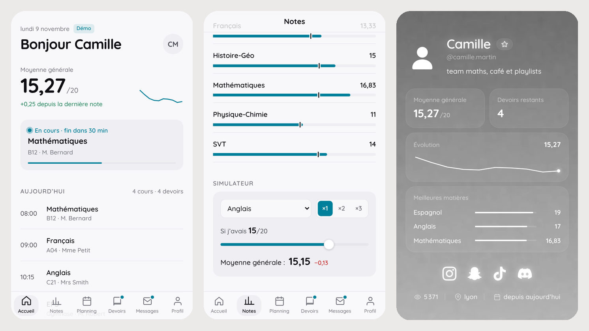

<div align="center">


# EcoleDirecte Option

**Une interface épurée et mobile-first pour suivre sa scolarité sur École Directe.**<br />
Notes en graphiques, emploi du temps, devoirs, et un profil public façon guns.lol.

[](LICENSE)


[](https://github.com/purmea/ecoledirecteoption/issues)

<br />



</div>

> [!NOTE]
> Projet **non officiel**, sans lien avec Aplim / École Directe. Il s'appuie sur l'API non documentée
> d'École Directe ([documentation communautaire](https://github.com/EduWireApps/ecoledirecte-api-docs)),
> qui peut changer à tout moment. Un **mode démo** permet d'essayer l'app sans compte.

## Fonctionnalités

**Au quotidien**

- **Accueil** : moyenne qui défile, carte « En cours · fin dans 30 min » / « Prochain cours dans… », dernières notes, devoirs à faire
- **Notes** : courbe d'évolution, barres par matière comparées à la classe, détail de chaque note, choix du trimestre
- **Simulateur** : « et si j'avais 15/20 en maths (coef 2) ? » → l'effet immédiat sur la moyenne générale
- **Planning** : emploi du temps navigable semaine par semaine (flèches ou glissement du doigt), cours annulés et cours en cours mis en avant
- **Messages** : boîte de réception avec non lus, ouverture d'un message (marqué comme lu), pièces jointes listées
- **Devoirs** : consignes groupées par date, cases à cocher synchronisées avec École Directe, confettis quand tout est fait

**Profil public** (`#/u/ton-pseudo`)

- Page au style « clean » : fond image ou vidéo, musique, effets (pluie, neige, étoiles…), couleurs, réseaux, badges, widgets de moyennes
- Pseudo unique, photo, bio, localisation, compteur de vues, présence Discord

**Confort**

- Thème clair, sombre ou automatique, **6 couleurs d'accent au choix** (turquoise, bleu, vert, orange, rose, graphite), pensé pour le téléphone (encoches, barre du bas, PWA)
- Animations façon Apple : ressorts physiques, pages qui glissent dans le sens de la navigation, barre du bas à bulle mobile, onglets qui glissent, titre qui se réduit au défilement, messages « Dynamic Island »
- **Hors connexion** : l'app s'ouvre instantanément avec tes dernières données (gardées sur l'appareil) puis se met à jour ; tirer vers le bas pour actualiser
- HTML sémantique, ARIA, focus visible, respect de « réduire les animations »

## Démarrage rapide

Prérequis : **Node.js ≥ 20.19** et npm.

```bash
git clone https://github.com/purmea/ecoledirecteoption.git
cd ecoledirecteoption
npm install
npm run dev
```

Ouvre <http://localhost:5173>. Pour tester sur ton téléphone (même Wi-Fi), ouvre l'adresse `Network` affichée dans le terminal.

En production :

```bash
npm run build
npm start        # http://localhost:8080  (PORT=… pour changer)
```

> [!TIP]
> Pas de compte sous la main ? Clique sur **« Essayer avec la démo »** sur l'écran de connexion.

## Scripts

| Commande | Rôle |
| --- | --- |
| `npm run dev` | Serveur de développement (app + proxy + API des profils) |
| `npm run build` | Vérifie les types puis construit `dist/` |
| `npm run preview` | Sert la version construite en local |
| `npm start` | Serveur de production : `dist/` + proxy + API des profils |
| `npm run typecheck` | Vérification TypeScript seule |

## Comment ça marche

### Connexion à École Directe

Le navigateur ne peut pas appeler `api.ecoledirecte.com` directement (pas de CORS, cookie `GTK` illisible
par un script). L'app passe par un **petit proxy Node** branché sur `dev`, `preview` et `start` :

```
navigateur ──► /ed/v3/…  (serveur de l'app) ──► api.ecoledirecte.com/v3/…
```

- Il gère le flux de connexion observé sur le vrai site : cookie `GTK` **et** second cookie `httponly`, QCM
  « nouvel appareil » avec l'en-tête `2FA-Token`, `cn`/`cv` mémorisés si « Rester connecté » est coché.
- Il ne relaie que les routes `/v3/*.awp` et **n'enregistre jamais** les identifiants.
- Sans le serveur (version statique seule), seule la démo fonctionne : l'écran de connexion le détecte et le dit.
- Seuls les **comptes élèves** sont pris en charge pour l'instant.
- **Messagerie** : la liste des messages n'est pas décrite dans la documentation communautaire ; sa lecture est
  tolérante (une réponse inattendue affiche un message d'erreur clair, jamais un plantage). Le contenu des
  messages est converti en texte : aucun HTML d'École Directe n'est injecté dans la page.
- Derrière un proxy d'entreprise : `NODE_USE_ENV_PROXY=1 npm run dev`.

### Profils publics

- **Pseudo unique** (3 à 20 caractères : `a-z`, `0-9`, `_`, `.`), vérifié en direct ; en changer libère l'ancien.
- **Propriété** : au login réussi, le serveur lie la session de l'appareil au compte élève ; seule cette session
  peut modifier le profil ou envoyer des fichiers. Un profil ne peut utiliser que ses propres médias.
- **Médias** : images (converties en WebP côté navigateur), GIF, vidéos MP4/WebM, audio. SVG refusés, type de
  contenu fixé (`nosniff`), fichiers inutilisés supprimés automatiquement.
- **Widgets** : instantané des moyennes, mis à jour à chaque publication et actualisation. **Rien n'est public
  tant que tu ne publies pas.**
- **Stockage** : `data/` (ignoré par git), ou `$DATA_DIR`. En mode démo, tout reste sur l'appareil.
- **Discord** (avatar, décoration, présence) via [Lanyard](https://github.com/Phineas/lanyard).

| Route | Rôle |
| --- | --- |
| `GET /api/u/:pseudo` | Profil public (+1 vue) |
| `GET /api/handles/:pseudo` | Disponibilité d'un pseudo |
| `GET` · `PUT` · `DELETE /api/me/profile` | Lire, enregistrer, supprimer son profil |
| `POST /api/media` · `GET /api/media/:fichier` | Envoyer / lire un média |

## Structure

```
src/
├── pages/        Accueil, Notes, Planning, Devoirs, Messages, Profil, Profil public, Réglages, Connexion
├── components/   Graphiques, navigation, simulateur, carte « maintenant »
├── profile/      Profils publics : types, API, page, effets, réseaux, Discord
├── api/          Client École Directe + conversion des données
├── state/        Session : connexion, QCM, démo, chargement
├── fx/           Messages, confettis, compteur animé, vibration
├── spring.css    Ressorts physiques (courbes linear()) utilisés par animations.css
└── styles.css    Design tokens + styles (clair & sombre)
server/
├── ed-proxy.mjs  Proxy vers École Directe
├── profiles.mjs  API des profils publics
└── serve.mjs     Serveur de production
```

## Feuille de route

- [x] Interface mobile-first, thèmes clair / sombre, PWA
- [x] Connexion École Directe (élève) avec QCM
- [x] Notes en graphiques, simulateur, planning, devoirs
- [x] Profils publics : médias, effets, couleurs, réseaux, badges, Discord, widgets
- [ ] Comptes parents (plusieurs enfants)
- [x] Messagerie : lecture des messages reçus
- [ ] Messagerie : répondre, envoyer, télécharger les pièces jointes
- [ ] Vie scolaire (absences, retards)
- [ ] Mode hors-ligne (service worker)
- [ ] Notifications de nouvelles notes
- [ ] Application mobile native (iOS)

## Contribuer

1. Forkez le projet et créez une branche (`git checkout -b feature/ma-fonctionnalite`)
2. Vérifiez que `npm run build` passe
3. Commitez, poussez, puis ouvrez une Pull Request

## Licence

[MIT](LICENSE)

## Contact

**@mea et @sofki** · [@purmea](https://github.com/purmea) · [shawtybae@atomicmail.io](mailto:shawtybae@atomicmail.io)

<div align="center"><sub>Fait par @mea et @sofki</sub></div>
